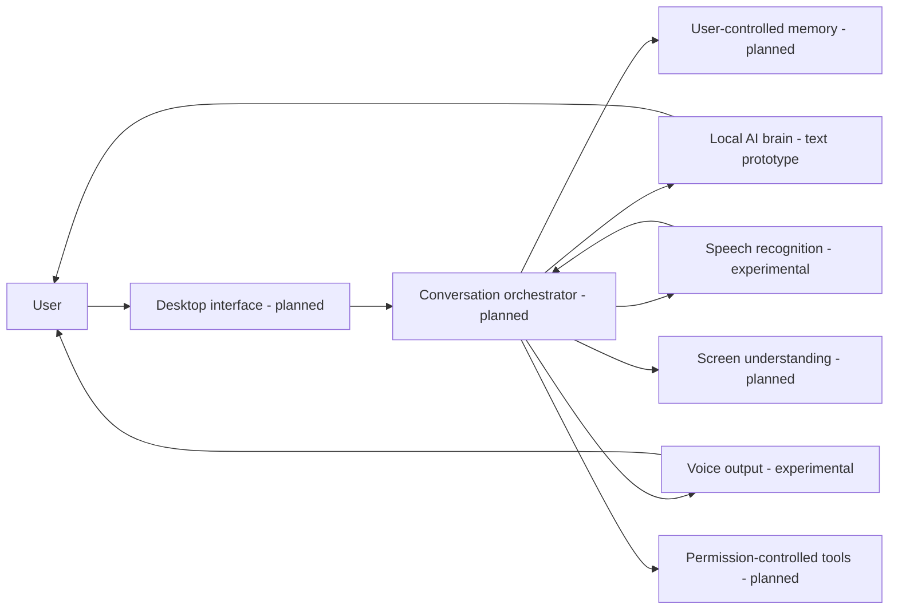

# SEREN

> **Your AI. Your Desktop. Your Assistant.**

SEREN is an early-stage AI desktop assistant project exploring a local-first approach to conversational AI, speech interaction, and permission-aware desktop productivity. Its open-source goal is to grow into a modular assistant that brings conversation, voice, memory, screen understanding, and approved tools into one coherent Windows experience. The repository does not yet include a software license.

**Status:** Early development. The repository currently contains a local Ollama text-chat script, a separate experimental voice core, and standalone wake-word experiments. The full product vision is not implemented.

## Project vision

SEREN aims to make computer interaction feel more natural while keeping the user in control. Conversations and speech are the current areas of experimentation. Future work may add user-authorized screen context, configurable memory, email integrations, and carefully scoped desktop tools.

### Why SEREN exists

AI assistants can help with everyday work, but useful desktop assistance needs clear boundaries. SEREN’s direction is to combine natural interaction with explicit permissions, understandable controls, and local-first components where practical. The current code is a starting point, not a finished assistant.

## Features and availability

| Area | Status | What the current repository supports |
|---|---|---|
| Text conversation | **Implemented** | `main.py` sends a text conversation to a local Ollama service using the configured `qwen3:8b` model and retains conversation context in process memory. |
| Voice conversation | **Experimental** | `seren_v3_fast.py` contains a microphone, speech-turn, transcription, Ollama, and speech-output pipeline. The voice path has not been verified as an end-to-end installation. |
| Speech recognition | **Experimental** | The voice core expects a local `whisper.cpp` server and Whisper model; language auto-detection and translation options are configured in its launch arguments. |
| Speech output | **Experimental** | The voice core uses Edge TTS. This requires network access to the speech service and is not local synthesis. |
| Turn detection and interruption | **Experimental** | Voice code includes VAD, audio processing, queue handling, and interruption-related logic; hardware behavior is unverified. |
| Wake-word detection | **Experimental** | `wake_listener.py` and `wake_test.py` separately exercise openWakeWord with the temporary “Hey Jarvis” model. They do not activate the voice core as one integrated assistant. |
| “Hey Seren” wake activation | **Planned** | The custom wake model and integration are not present. |
| Screen understanding | **Planned** | No screen capture or screen-question-answering feature is present in this repository. |
| Email assistance | **Planned** | No email integration or email access is present. |
| Persistent memory and settings | **Planned** | Conversation context is in memory for the running process; persistent, user-managed memory and preference controls are absent. |
| Desktop interface and automation | **Planned** | No desktop GUI or general computer-action system is present in this repository. |

“Implemented” describes source code present in the repository; it does not mean that a feature has passed a release test. “Experimental” features may require additional setup and hardware and have not been verified as a complete experience.

## Why local-first

SEREN’s architecture direction favors local components for inference and sensitive context where practical. In the current code, Ollama and the expected Whisper server use loopback addresses. However, Edge TTS is an online service in the voice path, and the standalone wake scripts may download model files. Do not assume every current component operates offline or that the project has completed a privacy audit.

## Architecture

The diagram below shows the intended product direction. Only the text-chat and experimental voice paths described above exist in the current repository; the other modules are planned.



## Technology

### Used by current source

- **Python** for the text and voice scripts.
- **Ollama** with `qwen3:8b` configured for local text generation.
- **whisper.cpp** server and a Whisper large-v3-turbo quantized model are expected by the experimental voice core; setup scripts build the server and download the model.
- **Edge TTS** for experimental speech output. It requires a network connection.
- **NumPy, PyAV, Requests, sounddevice, WebRTC VAD, and pywebrtc-audio** are imported by the voice core.
- **openWakeWord** is used by separate wake detection scripts.

`faster-whisper` is imported unconditionally by the voice file, although a source comment describes it as a stale-install check; transcription is sent to the separate whisper.cpp HTTP server. The setup script does not install `faster-whisper`, so the voice core may fail to start if it is unavailable. Piper is not used in the current repository. No dependency manifest or pinned Python requirements file is present.

## Installation and setup

### Text-chat prototype

Requirements: Python 3 and [Ollama](https://ollama.com/) installed locally. In a terminal, download the configured model and ensure the Ollama service is running:

```powershell
ollama pull qwen3:8b
ollama serve
```

In a second terminal, from the repository directory, run:

```powershell
python .\main.py
```

The script connects to `http://127.0.0.1:11434/api/chat`. It does not require third-party Python packages. Enter `/clear` to clear the in-process conversation, `/think` or `/fast` to change the request flag, and `/exit` to quit. Model behavior for the extra `think` field depends on the installed Ollama/model version and has not been verified here.

### Experimental voice core (Windows)

The voice path has substantial external requirements: Windows, Python, Ollama with `qwen3:8b`, Git, CMake, Visual Studio C++ build tools/MSVC, the Vulkan SDK, audio input/output devices, and network access for Edge TTS and the setup downloads.

The existing `setup_seren_step1_fixed.ps1` expects `.venv\Scripts\python.exe` to exist, installs unpinned packages, clones or updates whisper.cpp, builds it, and downloads a large model. Review that script and its effects before running it. The setup script has not been validated as a reproducible installation. The setup script’s final instruction points to `seren_v2.py`, which is absent from this repository; the voice-core file present here is `seren_v3_fast.py`.

After separately satisfying the prerequisites and confirming the expected server/model paths, the source entry point is:

```powershell
python .\seren_v3_fast.py
```

This is an experimental path, not a supported one-command installation. The voice core starts local Ollama and whisper.cpp processes when needed. The custom “Hey Seren” activation is not integrated; the wake listener scripts run independently.

## Configuration

The current scripts hard-code the Ollama endpoint (`127.0.0.1:11434`), model (`qwen3:8b`), Whisper endpoint/port (`127.0.0.1:8088`), model file path, and several voice settings in Python. There are no application environment variables, `.env` file, or configuration interface in the repository, so no `.env.example` is provided. Do not put credentials or private values into source files.

## Privacy and security

- The current chat and Whisper endpoints are configured for loopback use; this is not a complete security guarantee.
- Voice synthesis uses Edge TTS and therefore requires an external service. Review that service’s data handling before speaking sensitive information.
- Wake-word setup may download model files. Inspect scripts before running them.
- The current repository contains no screen-reading, email-access, persistent-memory, or general computer-control feature.
- Future integrations should require explicit user authorization, show when sensitive context is being used, provide revocation/deletion controls, and avoid unrestricted execution of model-generated commands.
- Report suspected vulnerabilities privately to the repository maintainer. Do not include credentials, personal data, or sensitive audio in public issues.

## Roadmap

The roadmap reflects source review on the current `main` branch. “Implemented” means code is present, not release-ready.

| Module | Status | Scope |
|---|---|---|
| **SEREN Core** | **Planned** | Modular orchestration and a stable desktop-assistant foundation. Current scripts are separate prototypes. |
| **SEREN Brain** | **Implemented (prototype)** | Local Ollama text chat in `main.py`; model selection is currently hard-coded. |
| **SEREN Ears** | **Experimental** | Speech recognition through an expected local whisper.cpp server in the voice core. |
| **SEREN Voice** | **Experimental** | Edge TTS output in the voice core; output currently depends on an online service. |
| **SEREN Wake** | **Experimental** | Standalone openWakeWord detection for “Hey Jarvis”; custom “Hey Seren” activation is planned. |
| **SEREN Memory** | **Planned** | User-controlled persistent memory, preferences, export, and deletion controls. |
| **SEREN Vision** | **Planned** | Screen understanding with explicit permission and visible capture controls. |
| **SEREN Mail** | **Planned** | Authorized email integration, summaries, organization, and reviewable drafts. |
| **SEREN Desktop** | **Planned** | A Windows desktop interface with clear permission and privacy controls. |
| **SEREN Automation** | **Planned** | Permission-controlled productivity tools with confirmation for consequential actions. |

## Known limitations

- The repository has no pinned dependency manifest, automated test suite, CI workflow, release package, or supported installation matrix.
- Text chat uses a hard-coded model name and local endpoint; its extra reasoning flag may not be honored by every Ollama version.
- Voice setup requires native Windows build tools, a GPU/Vulkan toolchain as configured by the scripts, audio hardware, large model downloads, and manual path prerequisites.
- The voice pipeline, audio-device handling, wake detection, model compatibility, and setup scripts have not been validated as a reproducible release.
- “Hey Seren” activation is not implemented; wake-word experiments use “Hey Jarvis” and are separate from the voice core.
- Edge TTS is not local processing. Email, screen understanding, persistent memory, a desktop application, and general automation are not implemented.

## Contributing

Contributions are welcome as the project’s scope and implementation mature. Before making a change, check the current issues and open a discussion for significant design work. Keep pull requests focused, describe the platform and hardware used, and include reproducible manual verification steps. Do not commit credentials, private audio, model files, personal data, or generated binaries. See [CONTRIBUTING.md](CONTRIBUTING.md) and [SECURITY.md](SECURITY.md).

## License

No `LICENSE` file is present in this repository. Until the author selects and adds a license, the code is publicly viewable but is not expressly licensed for reuse. Before adding one, confirm ownership of the project code and review third-party code, model, and asset terms. An OSI-approved license such as MIT or Apache-2.0 could be considered after that review; this README does not grant a license.

## Project links

- [Source repository](https://github.com/AnugrahM/Serene)
- [Roadmap](ROADMAP.md)
- [Contributing](CONTRIBUTING.md)
- [Security policy](SECURITY.md)
